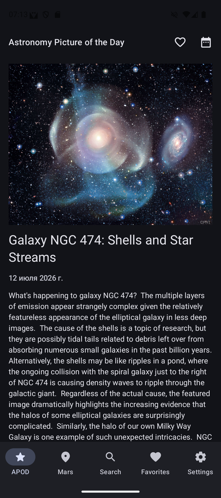
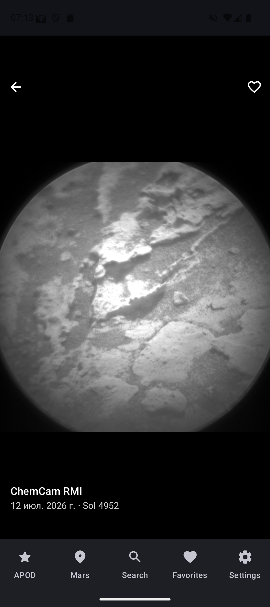
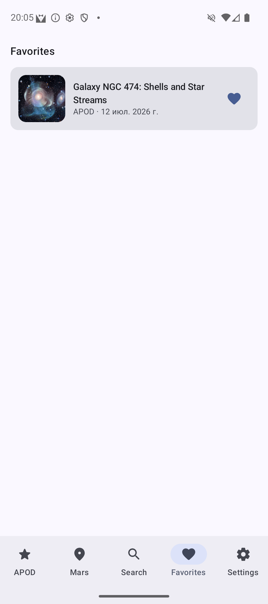
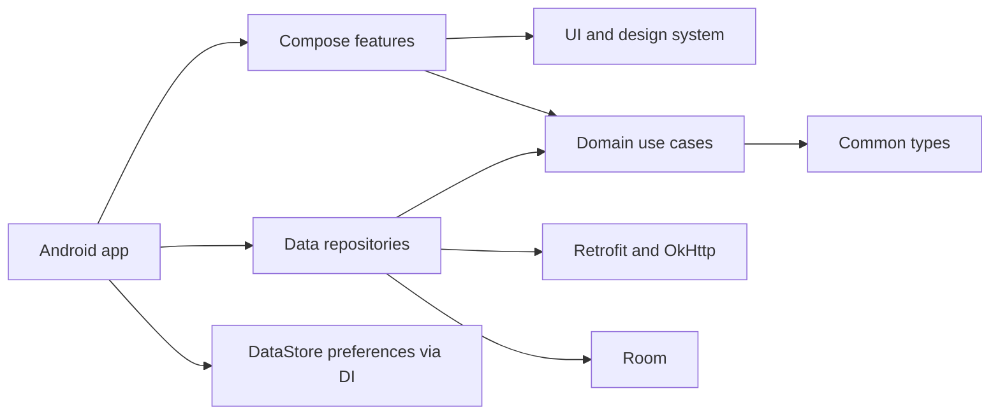

<div align="center">

# Cosmos

**A pocket atlas of NASA photography for Android**

Explore a day in the astronomy archive, follow a rover's camera across Mars, or keep a collection of your favourite discoveries.

[](https://github.com/higheroffpropane/cosmos/actions/workflows/ci.yml)
&nbsp; **Android 8.0+** · **Kotlin** · **Jetpack Compose**

</div>

| Astronomy Picture of the Day | Rover gallery | Photo detail |
|:---:|:---:|:---:|
|  |  |  |

## Explore the app

- **Astronomy Picture of the Day.** Browse dates back to 16 June 1995. Read the explanation alongside the image, or open a video entry in an external player.
- **Mars rovers.** Browse Curiosity and Perseverance photographs, filter by camera, and zoom in on a frame. The gallery reads from Room while Paging fetches more photos.
- **NASA Image Library.** Search after a short typing pause, load more matches as you scroll, and revisit recent searches. Clearing the field returns to history.
- **Favorites.** Bookmark a rover image or an APOD entry. Saved titles and details live in Room. Images are prefetched to Coil's disk cache and can be viewed offline while cached.
- **Daily reminder.** Enable a WorkManager notification for APOD, switch between light, dark and system themes, or clear cached media in Settings.

<details>
<summary>View the collection and settings screens</summary>

| Saved entries | Settings |
|:---:|:---:|
|  |  |

</details>

## Run locally

Use **JDK 21** and **Android SDK Platform 37**. The app runs on **API 26 or later**. Open the project in Android Studio and select the `app` run configuration, or use the Gradle wrapper from the repository root.

```sh
./gradlew :app:assembleDebug
./gradlew :app:installDebug    # With a device or emulator connected
```

On Windows, replace `./gradlew` with `.\gradlew.bat`. The debug APK is written to `app/build/outputs/apk/debug/app-debug.apk`.

**Data access.** The Mars gallery and Image Library search work without a NASA key. For APOD and its daily notification, obtain a [NASA API key](https://api.nasa.gov/) and add this line to your local `local.properties` file, alongside any Android SDK settings. Then rebuild.

```properties
NASA_API_KEY=your_key_here
```

The build also reads the `NASA_API_KEY` environment variable. The project ignores `local.properties`. The configured key is compiled into the client, so use a development key when sharing builds.

## Inside the project



| Layer | Implementation | An example in the code |
|:---|:---|:---|
| Presentation | Compose, Material 3, typed navigation, ViewModels, StateFlow | [Debounced media search and saved query state](feature/search/src/main/kotlin/com/dskochilov/cosmos/feature/search/SearchViewModel.kt) |
| Data | Retrofit, OkHttp, kotlinx.serialization, Room, Paging 3 | [RemoteMediator for the rover feed](core/data/src/main/kotlin/com/dskochilov/cosmos/core/data/mars/MarsPhotoRemoteMediator.kt) |
| Domain | Kotlin/JVM repository contracts and use cases | [Favorite operations shared by features](core/domain/src/main/kotlin/com/dskochilov/cosmos/core/domain/favorites/FavoritesUseCases.kt) |
| Android services | Hilt, WorkManager, Coil, Preferences DataStore | [Daily APOD worker](feature/apod/src/main/kotlin/com/dskochilov/cosmos/feature/apod/work/DailyApodWorker.kt) |
| Build | Gradle Kotlin DSL, version catalog, convention plugins, KSP | [Shared build conventions](build-logic/convention/src/main/kotlin/com/dskochilov/cosmos/buildlogic) |

**Two design choices shape the experience.** NASA mission-site feeds supply rover images. Their undocumented response formats are isolated in the network and data layers. Favorites store a snapshot of each entry, which keeps the collection readable even when its source is unavailable. Clearing the cache can remove the saved image bytes while preserving the entry. [Mars data source decision](docs/adr/0006-mars-data-source-pivot.md) · [Offline storage decision](docs/adr/0007-favorites-and-offline-strategy.md) · [All architecture decisions](docs/adr/)

## Verify a change

```sh
./gradlew check                 # JVM tests, Android lint, ktlint and detekt
./gradlew connectedDebugAndroidTest   # Device or emulator required
```

JVM tests cover state transitions, mappings, repositories and paging. Instrumented tests exercise Room, the rover mediator, the daily worker and Compose screens. The [CI workflow](.github/workflows/ci.yml) runs the static checks and JVM tests, then assembles a debug APK.

For local release testing, `./gradlew :app:assembleRelease` builds an R8-minified APK signed with the debug key. Configure a separate release signing key before distribution.
