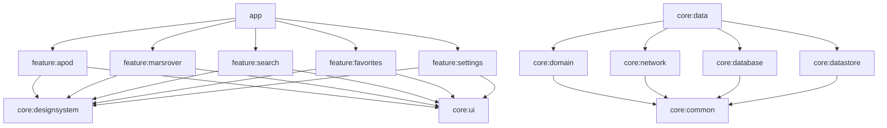

# Cosmos 🔭

A NASA data explorer for Android — a portfolio app built with the modern (2026) Android stack.

> **Status:** Phase 0 — walking skeleton (multi-module structure, design system, navigation shell, CI). Features land phase by phase; see [CLAUDE.md](CLAUDE.md) for the roadmap.

## Planned features

- **APOD** — Astronomy Picture of the Day with history browsing
- **Mars Rover Photos** — infinite-scroll feed (Paging 3 + RemoteMediator)
- **NASA Media Library search** — debounced search with history
- **Favorites** — offline-first local collection
- **Daily APOD notification** — WorkManager
- **Settings** — theme, dynamic color, notifications (DataStore)

## Tech stack

| Area | Choice |
|---|---|
| UI | Jetpack Compose, Material 3, edge-to-edge, dynamic color |
| Navigation | Navigation Compose with type-safe (kotlinx.serialization) routes |
| Architecture | Clean Architecture + MVI, multi-module |
| DI | Hilt (KSP) |
| Async | Coroutines + Flow |
| Build | Gradle (Kotlin DSL), version catalog, convention plugins in `build-logic/`, AGP 9 built-in Kotlin |
| Quality | detekt + ktlint (both with Compose rules), GitHub Actions CI |

## Module graph



Rules: features never depend on other features; `core:domain` and `core:common` are pure JVM modules; DTOs, entities, and domain models are separate classes with explicit mappers.

## Building

1. Get a free API key at [api.nasa.gov](https://api.nasa.gov).
2. Add it to `local.properties` (never committed):
   ```properties
   NASA_API_KEY="your_key_here"
   ```
3. Build:
   ```
   ./gradlew :app:assembleDebug
   ```
4. Run all checks (ktlint, detekt, Android lint, unit tests):
   ```
   ./gradlew check
   ```

## Decisions & trade-offs

Significant decisions are recorded as ADRs in [docs/adr/](docs/adr/).
