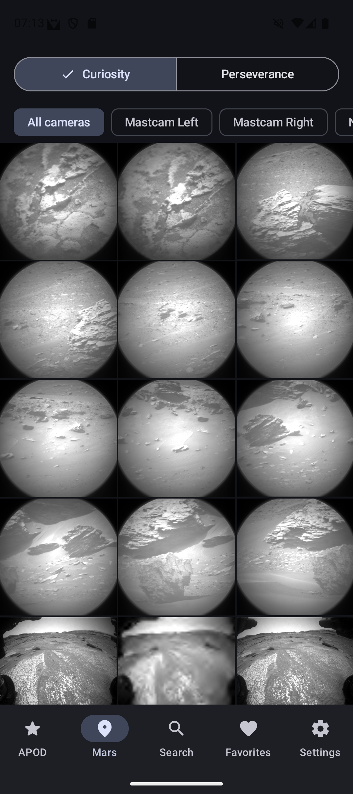
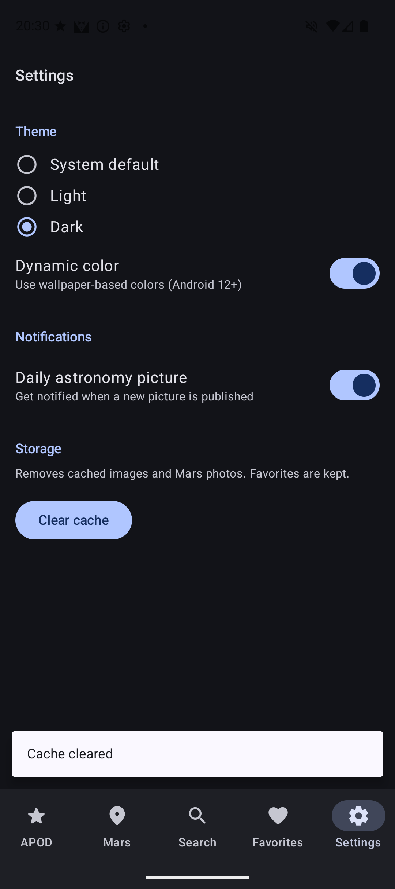
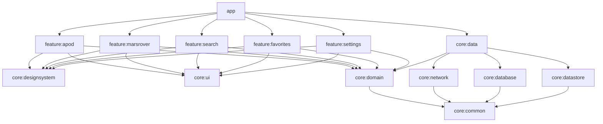

# Cosmos 🔭

A NASA data explorer for Android, built as a portfolio project on the modern (2026) Android stack:
100% Jetpack Compose, Clean Architecture + MVI, multi-module with convention plugins, offline-first
where it matters.

| APOD | Mars Rover feed | Photo detail | Favorites | Settings |
|---|---|---|---|---|
|  |  |  |  |  |

## Features

- **APOD** — today's Astronomy Picture of the Day with a date picker constrained to the archive
  (1995-06-16 → today); video entries show a thumbnail and open externally
- **Mars Rover photos** — infinite feed for Curiosity and Perseverance (Paging 3 +
  RemoteMediator, Room as single source of truth), camera filters, pinch-to-zoom detail with a
  shared-element transition
- **Media library search** — debounced search over `images-api.nasa.gov` with paginated results
  and Room-backed search history
- **Favorites** — save APOD entries and Mars photos; fully viewable offline including images
  (prefetched into Coil's disk cache on save)
- **Daily APOD notification** — WorkManager-scheduled, network-constrained with exponential
  backoff, respecting the POST_NOTIFICATIONS runtime permission
- **Settings** — theme (system/light/dark), dynamic color, notification toggle, clear cache —
  persisted in DataStore
- **Offline behavior** — feeds show cached data under an offline banner when refresh fails;
  favorites always work offline

## Tech stack

| Area | Choice |
|---|---|
| Language / build | Kotlin 2.3, Gradle 9.4, AGP 9.2 (built-in Kotlin), version catalog, convention plugins in `build-logic/`, KSP |
| UI | Jetpack Compose + Material 3, edge-to-edge, dynamic color, adaptive navigation (bottom bar ↔ rail), shared-element transitions |
| Architecture | Clean Architecture + MVI (sealed state / intents / effects), unidirectional data flow |
| DI | Hilt (KSP), `@HiltWorker` for WorkManager |
| Async | Coroutines + Flow only |
| Network | Retrofit 3 + OkHttp 5 + kotlinx.serialization; API key via OkHttp interceptor from `local.properties`/CI secret |
| Local | Room (v3, auto-migrations, exported schemas), DataStore Preferences |
| Pagination | Paging 3 — RemoteMediator for the Mars feed, plain PagingSource for search |
| Images | Coil 3, 256 MB disk cache, disk-only prefetch for favorites |
| Quality | detekt + ktlint (both with Compose rule sets), JUnit 5, MockK, Turbine, Compose UI tests, GitHub Actions CI |

## Architecture

- Features never depend on other features; cross-feature capabilities (e.g. the settings screen
  scheduling the APOD worker) go through interfaces in `core:domain`, wired by Hilt at the app level.
- `core:domain` and `core:common` are pure JVM modules.
- DTOs, Room entities and domain models are separate classes with explicit, unit-tested mappers.
- Repositories return domain models in a typed `AppResult`/`AppError`; raw exceptions never cross
  the domain boundary (Paging errors travel as `AppErrorException`).
- Every screen has explicit Loading / Content / Empty / Error states with retry.

## Testing

103 tests: 76 JVM unit tests (use cases, repositories, mappers, safe-call error mapping, ViewModel
MVI transitions with virtual-time debounce coverage) and 27 instrumented tests (RemoteMediator with
in-memory Room + fake API, DAOs, the WorkManager worker, Compose UI state rendering per feature).
CI runs ktlint, detekt, Android lint, unit tests and `assembleDebug` on every PR.

## Building

1. Get a free API key at [api.nasa.gov](https://api.nasa.gov).
2. Add it to `local.properties` (never committed): `NASA_API_KEY="your_key"`
   — CI/other environments can use a `NASA_API_KEY` environment variable instead.
3. `./gradlew :app:assembleDebug` to build, `./gradlew check` for the full quality gate.

### Release builds

`./gradlew :app:assembleRelease` produces an R8-minified, resource-shrunk build (~2.3 MB vs
~15 MB debug). It is debug-signed for local testing; for a Play-ready AAB create a keystore,
declare a `release` signing config (keystore path/passwords via `local.properties` or CI
secrets — never committed), point `buildTypes.release.signingConfig` at it, and run
`./gradlew :app:bundleRelease`.

## Decisions & trade-offs

Recorded as ADRs in [docs/adr/](docs/adr/):

- [0001](docs/adr/0001-multi-module-structure-with-convention-plugins.md) — multi-module structure and convention plugins
- [0002](docs/adr/0002-agp9-built-in-kotlin.md) — AGP 9 built-in Kotlin and version alignment
- [0003](docs/adr/0003-static-analysis-detekt-plus-ktlint.md) — detekt + ktlint side by side
- [0004](docs/adr/0004-mvi-presentation-pattern.md) — the MVI contract every feature follows
- [0005](docs/adr/0005-remotemediator-strategy-and-paging-in-domain.md) — RemoteMediator strategy; paging-common in the domain layer
- [0006](docs/adr/0006-mars-data-source-pivot.md) — pivot to live mars.nasa.gov feeds after the official Mars photos API died
- [0007](docs/adr/0007-favorites-and-offline-strategy.md) — favorites storage and offline image strategy

Notable trade-offs: the Mars feed uses NASA's undocumented-but-stable mission-site APIs (the
documented one is permanently offline — ADR 0006); favorites are denormalized snapshots (NASA
archive entries are effectively immutable); baseline profiles are left as future work.
